# Schéma relationnel

Ce diagramme synthétise les relations métier centrales déclarées dans les migrations.
Il omet les colonnes descriptives, les timestamps et les index non relationnels.
Les clés étrangères, contraintes composites et règles `CHECK` détaillées dans les
migrations restent la source de vérité.

```mermaid
erDiagram
    USERS {
        bigint id PK
        string email UK
        string role
        boolean is_active
    }
    GUARDIANS {
        bigint id PK
        bigint user_id FK
    }
    STUDENTS {
        bigint id PK
        bigint user_id FK
        bigint guardian_id FK
        string matricule UK
        string qr_token UK
    }
    TEACHERS {
        bigint id PK
        bigint user_id FK
        string matricule UK
    }
    SCHOOL_YEARS {
        bigint id PK
        string label UK
        boolean is_active
    }
    SCHOOL_YEAR_PERIODS {
        bigint id PK
        bigint school_year_id FK
        string period_type
        int period_number
    }
    LEVELS {
        bigint id PK
        string name UK
        string cycle
    }
    ROOMS {
        bigint id PK
        string name UK
    }
    CLASSROOMS {
        bigint id PK
        bigint school_year_id FK
        bigint level_id FK
        bigint room_id FK
        bigint head_teacher_id FK
        string name
    }
    SUBJECTS {
        bigint id PK
        string code UK
    }
    TEACHING_ASSIGNMENTS {
        bigint id PK
        bigint classroom_id FK
        bigint subject_id FK
        bigint teacher_id FK
    }
    ENROLLMENTS {
        bigint id PK
        bigint student_id FK
        bigint classroom_id FK
        bigint school_year_id FK
        string status
    }
    FEE_SCHEDULES {
        bigint id PK
        bigint school_year_id FK
        bigint level_id FK
        int monthly_amount
    }
    PAYMENTS {
        bigint id PK
        bigint enrollment_id FK
        bigint recorded_by FK
        bigint cancelled_by FK
        date month
        int amount
        string receipt_number UK
    }
    ATTENDANCE_SESSIONS {
        bigint id PK
        bigint classroom_id FK
        bigint subject_id FK
        bigint teacher_id FK
        bigint created_by FK
        date session_date
    }
    ATTENDANCES {
        bigint id PK
        bigint attendance_session_id FK
        bigint enrollment_id FK
        bigint classroom_id FK
        bigint marked_by FK
        string status
    }
    EVALUATIONS {
        bigint id PK
        bigint classroom_id FK
        bigint teaching_assignment_id FK
        bigint teacher_id FK
        bigint created_by FK
        bigint published_by FK
        date evaluation_date
    }
    GRADES {
        bigint id PK
        bigint evaluation_id FK
        bigint enrollment_id FK
        bigint classroom_id FK
        bigint entered_by FK
        decimal score
    }
    GRADE_CORRECTIONS {
        bigint id PK
        bigint grade_id FK
        bigint corrected_by FK
        decimal previous_score
        decimal new_score
    }
    ATTENDANCE_CORRECTIONS {
        bigint id PK
        bigint attendance_id FK
        bigint corrected_by FK
    }
    SCHEDULES {
        bigint id PK
        bigint classroom_id FK
        bigint teaching_assignment_id FK
        bigint room_id FK
        bigint created_by FK
    }
    ANNOUNCEMENTS {
        bigint id PK
        bigint created_by FK
        bigint classroom_id FK
        bigint school_year_id FK
    }
    ANNOUNCEMENT_USER {
        bigint announcement_id PK
        bigint user_id PK
        datetime read_at
    }
    GUARDIAN_CONVERSATIONS {
        bigint id PK
        bigint guardian_id FK
    }
    GUARDIAN_MESSAGES {
        bigint id PK
        bigint guardian_conversation_id FK
        bigint sender_id FK
    }

    USERS o|--o| GUARDIANS : "compte optionnel"
    USERS o|--o| STUDENTS : "compte optionnel"
    USERS o|--o| TEACHERS : "compte optionnel"
    USERS ||--o{ ATTENDANCE_SESSIONS : "crée"
    USERS ||--o{ EVALUATIONS : "crée / publie"
    USERS ||--o{ GRADES : "saisit"
    USERS ||--o{ GRADE_CORRECTIONS : "corrige"
    USERS ||--o{ SCHEDULES : "crée"
    USERS ||--o{ ATTENDANCE_CORRECTIONS : "corrige"
    GUARDIANS ||--o{ STUDENTS : suit

    SCHOOL_YEARS ||--o{ SCHOOL_YEAR_PERIODS : configure
    SCHOOL_YEARS ||--o{ CLASSROOMS : contient
    SCHOOL_YEARS ||--o{ ENROLLMENTS : couvre
    SCHOOL_YEARS ||--o{ FEE_SCHEDULES : fixe
    SCHOOL_YEARS o|--o{ ANNOUNCEMENTS : cible
    LEVELS ||--o{ CLASSROOMS : classe
    LEVELS ||--o{ FEE_SCHEDULES : tarifie
    ROOMS o|--o{ CLASSROOMS : accueille
    ROOMS ||--o{ SCHEDULES : héberge
    TEACHERS o|--o{ CLASSROOMS : "professeur principal"

    CLASSROOMS ||--o{ TEACHING_ASSIGNMENTS : distribue
    SUBJECTS ||--o{ TEACHING_ASSIGNMENTS : matière
    TEACHERS ||--o{ TEACHING_ASSIGNMENTS : enseigne
    CLASSROOMS ||--o{ ENROLLMENTS : inscrit
    STUDENTS ||--o{ ENROLLMENTS : historique
    ENROLLMENTS ||--o{ PAYMENTS : règle
    USERS ||--o{ PAYMENTS : "enregistre"
    USERS o|--o{ PAYMENTS : "annule"

    CLASSROOMS ||--o{ ATTENDANCE_SESSIONS : organise
    SUBJECTS o|--o{ ATTENDANCE_SESSIONS : "matière facultative pour appel quotidien"
    TEACHERS o|--o{ ATTENDANCE_SESSIONS : conduit
    ATTENDANCE_SESSIONS ||--o{ ATTENDANCES : pointe
    ENROLLMENTS ||--o{ ATTENDANCES : est_pointe
    USERS ||--o{ ATTENDANCES : marque
    ATTENDANCES ||--o{ ATTENDANCE_CORRECTIONS : "historique des corrections"

    TEACHING_ASSIGNMENTS ||--o{ EVALUATIONS : évalue
    CLASSROOMS ||--o{ EVALUATIONS : concerne
    TEACHERS ||--o{ EVALUATIONS : prépare
    EVALUATIONS ||--o{ GRADES : contient
    ENROLLMENTS ||--o{ GRADES : reçoit
    GRADES ||--o{ GRADE_CORRECTIONS : "historique des corrections"

    TEACHING_ASSIGNMENTS ||--o{ SCHEDULES : planifie
    CLASSROOMS o|--o{ ANNOUNCEMENTS : "cible de classe"
    USERS ||--o{ ANNOUNCEMENTS : publie
    ANNOUNCEMENTS ||--o{ ANNOUNCEMENT_USER : destinataires
    USERS ||--o{ ANNOUNCEMENT_USER : reçoit
    GUARDIANS ||--o| GUARDIAN_CONVERSATIONS : échange
    GUARDIAN_CONVERSATIONS ||--o{ GUARDIAN_MESSAGES : contient
    USERS ||--o{ GUARDIAN_MESSAGES : envoie
```

## Contraintes métier importantes

- Un compte peut être associé à un profil enseignant, parent ou élève; l'association est
  facultative et unique pour chaque profil.
- Un élève ne peut avoir qu'une inscription active par année scolaire. Les anciennes
  inscriptions sont conservées.
- La classe et l'année d'une inscription doivent correspondre. Les lignes de présence
  et de notes sont également contraintes à la même classe que l'inscription concernée.
- Une affectation associe une matière et un enseignant à une classe. Les évaluations et
  les emplois du temps référencent cette affectation.
- Une séance de présence est soit une séance de matière, soit un appel quotidien. Un
  appel quotidien est unique par classe et date.
- Les paiements ne sont pas supprimés : ils peuvent être annulés et conservent les
  références à l'auteur et au motif d'annulation.
- Les corrections de présence et de notes sont conservées dans des tables d'audit.
- Une annonce peut viser tous les utilisateurs ou une classe d'une année scolaire; la
  table pivot `announcement_user` conserve également l'état de lecture.
- `notifications`, les jetons Sanctum, les sessions, les tâches et les compteurs de
  reçus sont des tables techniques complémentaires non détaillées dans le diagramme.
